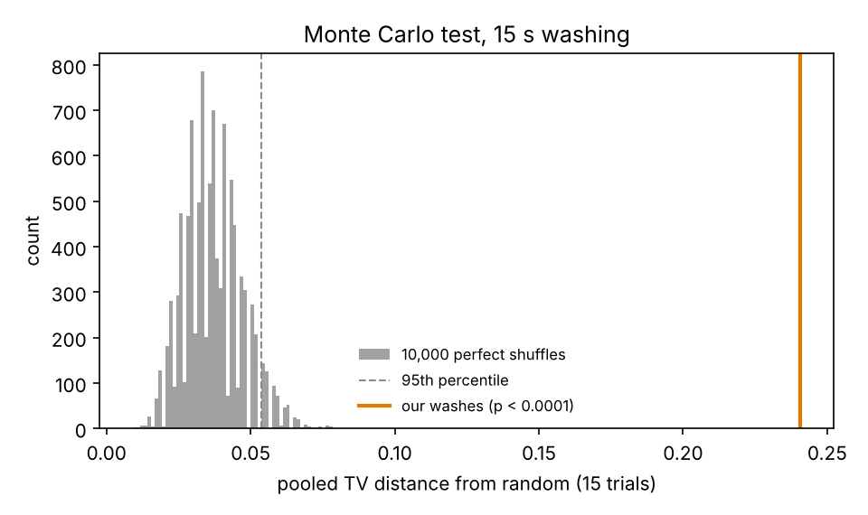
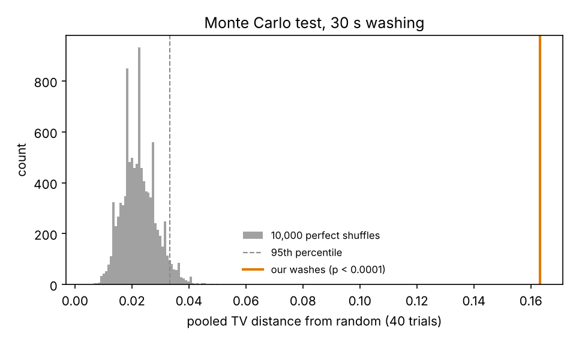
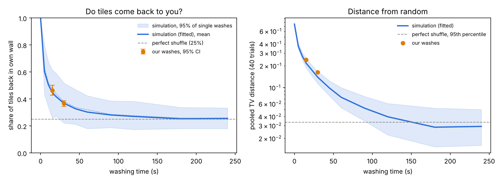
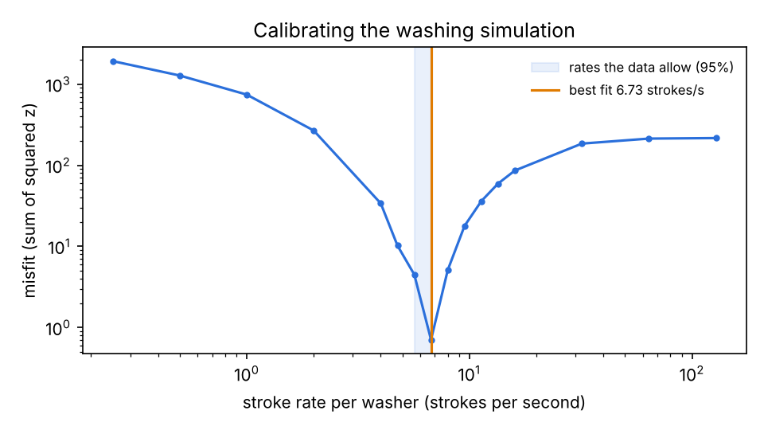
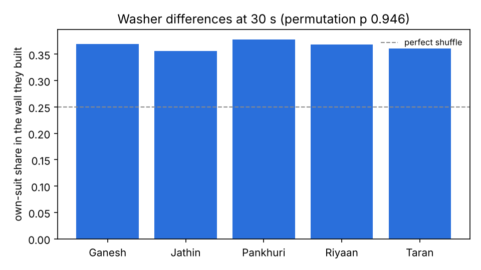

> **SYNTHETIC PLACEHOLDER DATA.** These numbers come from `make_synthetic_data.py`, not from real washing. They only show what the report will look like. Do not quote them.

# Mahjong washing: analysis report

Data: `synthetic_trials.csv`, 55 trials (15 at 15 s, 40 at 30 s). Typical (main) washing time: 30 s. Perfect-shuffle runs: 10,000. Seed 1110.

## 1. Is washing random? (Method 1, Monte Carlo test)

| Washing time | Trials | Own-wall share (95% CI) | Pooled TV (95% CI) | Perfect shuffle: mean TV, 95th pct | p-value | Verdict |
|---|---|---|---|---|---|---|
| 15 s | 15 | 46.4% (42.7%–50.2%) | 0.241 (0.217–0.306) | 0.037, 0.054 | < 0.0001 | not random |
| 30 s | 40 | 36.6% (34.5%–38.8%) | 0.163 (0.134–0.199) | 0.023, 0.033 | < 0.0001 | not random |

Chi-square cross-check (pooled 4×4 table, df 9):

- 15 s: χ² = 645.9, p = 3e-133, Cramér's V = 0.316
- 30 s: χ² = 603.4, p = 4e-124, Cramér's V = 0.187

Pooled table at 30 s (rows = where tiles started, columns = wall they ended in):

| start \ wall | E | S | W | N |
|---|---|---|---|---|
| E (dots) | 507 | 331 | 245 | 357 |
| S (bamboo) | 406 | 549 | 329 | 156 |
| W (characters) | 217 | 345 | 502 | 376 |
| N (honours_flowers) | 310 | 215 | 364 | 551 |

## 2. Do washers differ? (real data, 30 s)

| Washer | Walls built | Own-suit share in their wall |
|---|---|---|
| Ganesh | 30 | 36.9% |
| Jathin | 30 | 35.6% |
| Pankhuri | 30 | 37.8% |
| Riyaan | 30 | 36.9% |
| Taran | 40 | 36.0% |

- Washer effect: permutation p = 0.946
- Seat effect (E/S/W/N): permutation p = 0.314 (by seat: E 35.2%, N 38.3%, S 38.1%, W 34.9%)
- Drift over the session: r = +0.18, p = 0.256

Each wall's count depends on all four washers at once, so these tests are descriptive.

## 3. Washing simulation fitted to our data (Method 2)

Fitted stroke rate: **6.73 strokes per second per washer** (rates the data allow: 5.66–6.73). Other style settings fixed at {'rate': 'fitted', 'radius': 0.15, 'push': 0.2, 'reach': 0.7}, washer spread 25%.

| Washing time | Real own-wall share | Simulated (fitted) |
|---|---|---|
| 15 s | 46.4% ± 3.9% | 44.9% |
| 30 s | 36.6% ± 2.1% | 36.2% |

Predictions (fitted rate; detection chance = how often a 40-trial experiment would call it not random):

| Washing time | Own-wall share, mean (95% of washes) | Pooled TV, median | Detection chance |
|---|---|---|---|
| 0 s | 100.0% (100%–100%) | 0.750 | 100% |
| 5 s | 60.3% (43%–79%) | 0.372 | 100% |
| 10 s | 50.5% (34%–68%) | 0.274 | 100% |
| 15 s | 44.7% (26%–61%) | 0.217 | 100% |
| 20 s | 41.7% (27%–59%) | 0.188 | 100% |
| 30 s | 36.8% (22%–52%) | 0.139 | 100% |
| 45 s | 32.7% (21%–47%) | 0.099 | 100% |
| 60 s | 30.3% (18%–42%) | 0.074 | 100% |
| 90 s | 28.1% (19%–39%) | 0.052 | 96% |
| 120 s | 27.0% (17%–38%) | 0.040 | 64% |
| 180 s | 25.3% (18%–34%) | 0.028 | 21% |
| 240 s | 25.6% (18%–33%) | 0.029 | 21% |

**Washing time needed to look random** (a 40-trial test would detect non-randomness less than half the time): about 139 s at the fitted rate; about 139 s to about 164 s across the rates the data allow.

## 4. What if the washers were different? (simulation, 30 s)

| Washers | Own-wall share | E wall | Other walls |
|---|---|---|---|
| identical washers | 36.1% | 36.0% | 36.2% |
| typical differences (25%) | 35.8% | 35.3% | 36.0% |
| large differences (50%) | 39.5% | 40.0% | 39.3% |
| one lazy washer at E (30% of the rate) | 38.2% | 39.3% | 37.8% |
| one keen washer at E (twice the rate) | 34.6% | 34.8% | 34.6% |

## Plots

_Run time 637 s._
